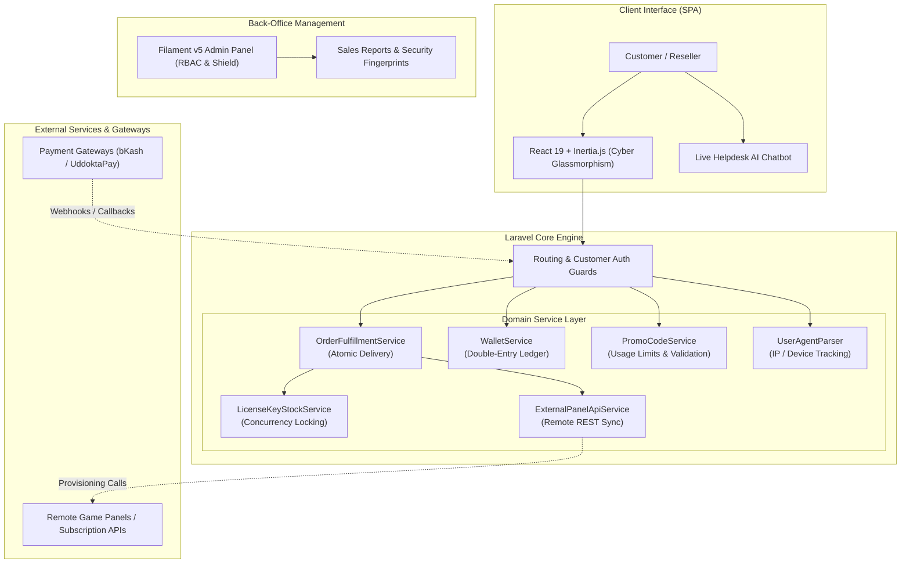

<div align="center">

# ⚡ NexusKey — Enterprise Digital Product & License Marketplace

[](https://laravel.com)
[](https://php.net)
[](https://react.dev)
[](https://inertiajs.com)
[](https://tailwindcss.com)
[](https://filamentphp.com)
[](https://pestphp.com)
[](LICENSE)

<p align="center">
  A high-concurrency, full-stack digital goods marketplace engineered for selling software activation keys, gaming panel subscriptions, and instant digital assets. Built with atomic stock reservation, automated webhook delivery, customer digital wallet ledger, and multi-tier reseller capabilities.
</p>

[Key Features](#-core-capabilities) •
[Architecture](#-system-architecture) •
[Tech Stack](#-tech-stack) •
[Installation](#-quick-start--installation) •
[Demo Accounts](#-demo-credentials) •
[Filament Admin](#-administrative-control-suite) •
[Testing](#-testing--code-quality)

---

</div>

## 📖 Executive Summary

**NexusKey** is a production-ready e-commerce platform designed from the ground up for software distributors, SaaS vendors, and digital gaming communities. 

Unlike conventional physical e-commerce systems, digital commerce demands specialized architectures: **zero-latency license key allocation, concurrency-safe inventory locking, automated remote panel API provisioning, pre-funded wallet transactions, and suspicious login fingerprinting.**

NexusKey combines the elegance of **Laravel (v12/v13)** with the responsiveness of a **React 19 SPA** via **Inertia.js v3**, styled with **Tailwind CSS v4** in a cyber-gaming glassmorphic aesthetic. The administrative layer is powered by **Filament v5** with granular Role-Based Access Control (RBAC).

---

## 🏗️ System Architecture



---

## 🌟 Core Capabilities

### ⚡ Concurrency-Safe Stock & Automated Fulfillment
- **Race-Condition Protection:** Utilizes database row-level locking (`lockForUpdate`) in `LicenseKeyStockService` to ensure keys cannot be double-sold during concurrent checkout spikes.
- **Instant Delivery Pipeline:** Licenses are automatically detached from the available stock pool and associated with the customer's order the millisecond payment is confirmed.
- **Bulk Import Engine:** High-volume CSV/batch key importer with automatic sanitization and duplicate detection (`LicenseKeyImportService`).
- **Product Safety & Setup Docs:** Direct delivery of setup guides, maintenance warnings, and downloadable binaries per product variant.

### 🎮 External Game Panel API Provisioning
- **Dynamic Key Generation:** Connects directly with remote game panels via `ExternalPanelApiService` to provision live user accounts or dynamic activation keys on demand.
- **Webhook Handlers:** Asynchronous callbacks and signature-verified webhook endpoints with automated retry safeguards.

### 💳 Customer Digital Wallet System
- **Double-Entry Financial Ledger:** Transparent tracking of all user deposits, purchases, refunds, and promo rewards with strict audit trails (`WalletService`).
- **1-Click Checkout:** Zero-friction purchases using pre-funded balances, bypassing external payment redirects.
- **Admin Adjustments:** Secure, audited manual balance credits/debits directly from the Filament admin panel.

### 👥 Modern Cyberpunk UX & Support Chatbot
- **Tailwind CSS v4 + React 19:** Custom-crafted dark mode with glassmorphic panels, neon accent glows, and smooth micro-interactions.
- **Mobile-First Experience:** Fixed floating navigation bar (`MobileBottomNav`) designed specifically for one-handed mobile browsing.
- **1-Tap Key Copier:** Protected, masked serial codes with instant one-click clipboard copying.
- **Live Helpdesk Chatbot:** Persistent interactive chatbot (`Chatbot.jsx`) capable of guiding customers through order tracking, wallet deposits, and key retrieval.

### 🛡️ Security, Audit & Admin Governance
- **Role-Based Access Control (RBAC):** Multi-tier roles (Super Admin, Store Manager) governed by Spatie Permission & Filament Shield.
- **Customer Security & Login Audits:** Captures IP addresses, operating systems, browsers, and timestamps (`LoginHistory`) to detect suspicious account sharing.
- **Dynamic Promo Engine:** Percentage and fixed discounts with usage ceilings, expiry controls, and per-user limits.
- **Executive Analytics:** Real-time revenue monitors, stock health indicators, and exportable financial reports (`SalesReportPage`).

---

## 🛠️ Tech Stack

| Domain | Technology / Package | Version | Description |
| :--- | :--- | :--- | :--- |
| **Backend Framework** | [Laravel](https://laravel.com) | `^12.0` / `^13.0` | Robust PHP web framework providing expressive architectural patterns |
| **Runtime Language** | [PHP](https://php.net) | `8.3+` / `8.5` | Modern typed PHP with constructor property promotion |
| **Frontend Framework** | [React](https://react.dev) | `^19.3` | High-performance declarative component rendering |
| **Client-Server Bridge** | [Inertia.js](https://inertiajs.com) | `^3.4` (PHP) / `^3.7` (React) | SPA architecture without client-side routing complexity |
| **CSS Framework** | [Tailwind CSS](https://tailwindcss.com) | `^4.0` | Next-generation utility-first styling with `@tailwindcss/vite` |
| **Administrative UI** | [Filament](https://filamentphp.com) | `^5.8` | Extensible administrative resource dashboards and forms |
| **Permissions** | [Spatie Laravel Permission](https://spatie.be) | `^8.3` | Role and permission authorization model |
| **Shield Generator** | [Filament Shield](https://github.com/bezhanSalleh/filament-shield) | `^4.3` | Automated Filament resource permission generator |
| **Testing Suite** | [Pest PHP](https://pestphp.com) | `^5.2` | Elegant, expressive PHP testing framework |
| **Code Style** | [Laravel Pint](https://laravel.com/docs/pint) | `^1.27` | Automated code formatting adhering to PSR-12 |

---

## 📋 System Requirements

Before setting up the project, make sure your machine meets these requirements:

- **PHP**: `^8.3`, `^8.4`, or `^8.5`
- **PHP Extensions**: `bcmath`, `ctype`, `curl`, `dom`, `fileinfo`, `mbstring`, `openssl`, `pdo`, `sqlite3` / `pdo_mysql`, `tokenizer`, `xml`
- **Composer**: `2.x+`
- **Node.js**: `>= 20.x`
- **NPM / Bun**: Latest stable version
- **Database**: SQLite (built-in default), MySQL `8.0+`, or PostgreSQL `14+`

---

## 🚀 Quick Start / Installation

Follow these steps to get a development environment up and running:

### 1. Clone Repository
```bash
git clone https://github.com/rakibhossainporosh/Digital-product-ecommerce.git
cd Digital-product-ecommerce
```

### 2. Install Dependencies
```bash
# Install PHP dependencies
composer install

# Install Node modules
npm install
```

### 3. Environment Setup
```bash
# Copy example environment configuration
cp .env.example .env

# Generate application key
php artisan key:generate
```

### 4. Database Setup & Seeding
```bash
# Runs migrations and populates sample catalog, admin users, and initial stock
php artisan migrate --seed
```

### 5. Compile Frontend Assets
```bash
# Build optimized production bundle
npm run build

# Or launch development server with Hot Module Replacement (HMR):
npm run dev
```

### 6. Start the Web Server
```bash
php artisan serve
```

- **Customer Storefront:** [http://127.0.0.1:8000](http://127.0.0.1:8000)
- **Filament Admin Dashboard:** [http://127.0.0.1:8000/admin](http://127.0.0.1:8000/admin)

---

## 🔑 Demo Credentials

The database seeders (`AdminUserSeeder`, `CustomerSeeder`) pre-populate test accounts:

### 🛡️ Administrative Accounts
| Role | Email | Password | Admin Access |
| :--- | :--- | :--- | :--- |
| **Super Admin** | `admin@example.com` | `password` | `/admin` (Full access) |
| **Store Manager** | `manager@example.com` | `password` | `/admin` (Restricted) |

### 👤 Customer Accounts
| Account Type | Email | Password | Initial Balance | Special Features |
| :--- | :--- | :--- | :--- | :--- |
| **VIP Reseller** | `reseller@example.com` | `password` | ৳ 3,550.00 | Tiered reseller discounts, active order history |
| **Standard Customer** | `customer@example.com` | `password` | ৳ 600.00 | Standard retail pricing |
| **Banned User** | `fraudster@example.com` | `password` | ৳ 0.00 | Demonstrates access rejection guard |

---

## 🧪 Testing & Quality Assurance

The codebase includes comprehensive feature tests covering core business workflows:

```bash
# Run entire test suite
php artisan test

# Or run tests using Pest directly
vendor/bin/pest

# Run focused critical path test suites
php artisan test tests/Feature/OrderFulfillmentTest.php
php artisan test tests/Feature/LicenseKeyManagementTest.php
php artisan test tests/Feature/PaymentGatewayTest.php
php artisan test tests/Feature/ProductManagementTest.php
```

### Code Formatting
Ensure strict PSR-12 code compliance using Laravel Pint:
```bash
vendor/bin/pint
```

---

## 📁 Key File Structure

```
app/
├── Enums/                          # Domain Enums (CustomerStatus, KeyStatus, OrderStatus...)
├── Filament/                       # Administrative Control Suite
│   ├── Pages/                      # Custom pages (ManageSettings, SalesReportPage)
│   └── Resources/                  # Filament CRUD Modules (Products, Orders, Keys...)
├── Http/
│   ├── Controllers/
│   │   ├── Auth/CustomerAuthController.php
│   │   ├── CheckoutController.php
│   │   ├── CustomerDashboardController.php
│   │   └── PaymentController.php
│   └── Middleware/                 # Customer Guards, Inertia Shared Data
├── Models/                         # Eloquent Models (Order, LicenseKey, Customer, Wallet...)
└── Services/                       # Core Business Logic Layer
    ├── ExternalPanelApiService.php # Remote game panel provisioning integration
    ├── LicenseKeyStockService.php  # Concurrency-safe key stock allocation
    ├── OrderFulfillmentService.php # Atomic order fulfillment and assignment
    ├── PaymentGatewayService.php   # Payment verification and webhooks
    ├── PromoCodeService.php        # Discount validation and user limits
    └── WalletService.php           # Digital customer wallet ledger operations
```

---

## 📄 License

This open-source project is distributed under the [MIT License](LICENSE).

---

<div align="center">
  <sub>Engineered with precision by <a href="https://github.com/rakibhossainporosh">Rakib Hossain Porosh</a></sub>
</div>
